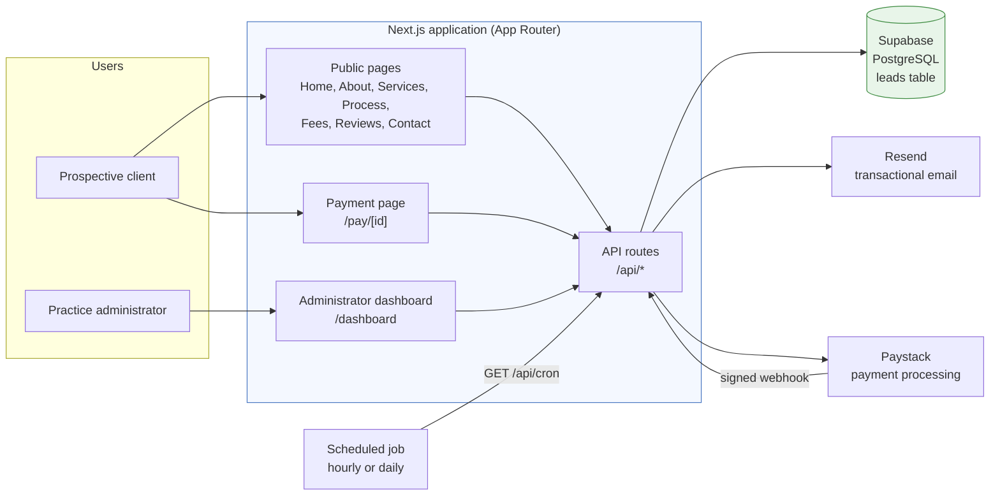
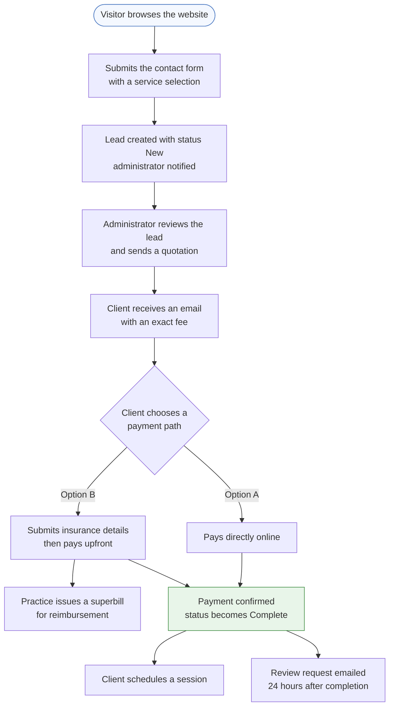
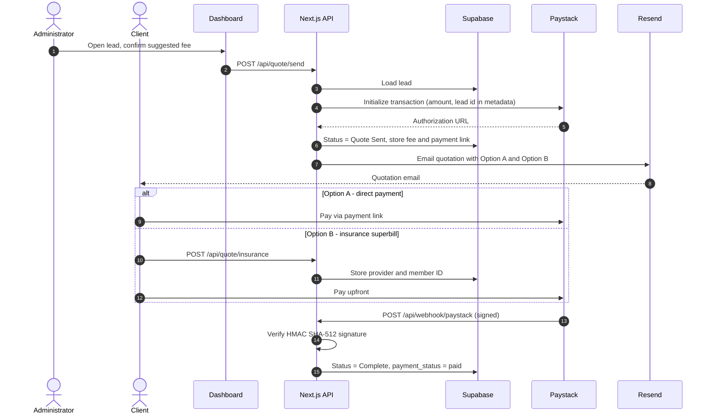
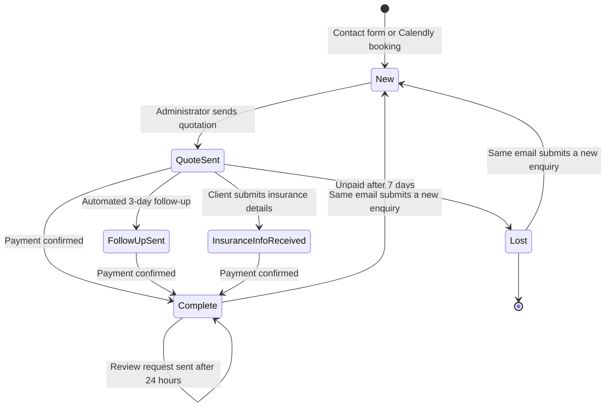
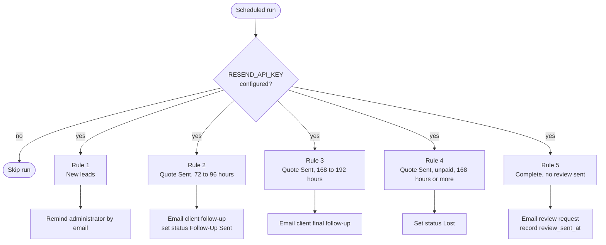
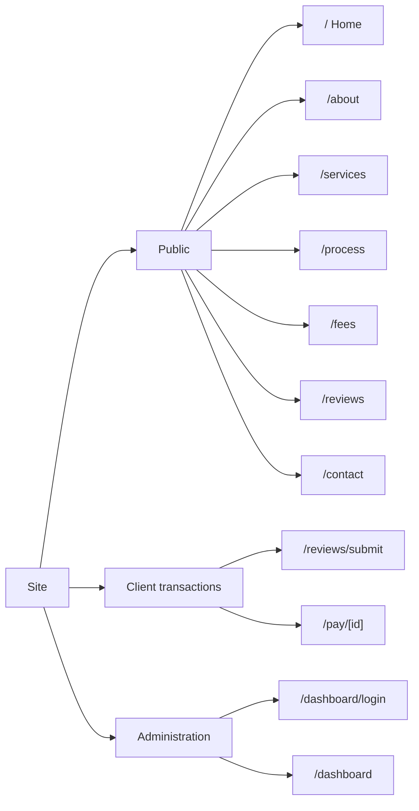
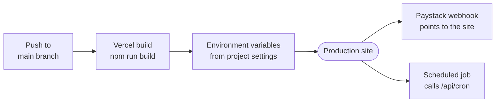

# Kelly Rogers Practice Platform

**A client-facing website and practice-management workflow for a private psychotherapy practice: public information pages, an intake form, an administrator dashboard for managing enquiries, fee quotations with online payment, and automated follow-up communications.**


---

## Table of Contents

1. [Overview](#1-overview)
2. [Key Capabilities](#2-key-capabilities)
3. [System Architecture](#3-system-architecture)
4. [Client Workflow](#4-client-workflow)
5. [Lead Lifecycle and Automation](#5-lead-lifecycle-and-automation)
6. [Application Structure](#6-application-structure)
7. [API Reference](#7-api-reference)
8. [Data Model](#8-data-model)
9. [Technology Stack](#9-technology-stack)
10. [Getting Started](#10-getting-started)
11. [Integration Setup](#11-integration-setup)
12. [Deployment](#12-deployment)
13. [Security, Privacy and Compliance](#13-security-privacy-and-compliance)
14. [Known Gaps and Roadmap](#14-known-gaps-and-roadmap)
15. [Repository Layout](#15-repository-layout)
16. [License and Ownership](#16-license-and-ownership)

---

## 1. Overview

The platform serves two audiences:

| Audience | Purpose |
|----------|---------|
| **Prospective and current clients** | Learn about the practice and its services, review fees and hours, submit an enquiry, receive a fee quotation by email, and pay online. |
| **Practice administrator** | Review incoming enquiries in a dashboard, issue an exact-fee quotation with one action, and rely on scheduled reminders and follow-ups. |

The practice operates from Virginia Beach, VA and offers telehealth and in-person sessions. The site presents four services: Divorce Coaching, Counselling and Stress Management, Clinical Support and Wellbeing, and Private Psychotherapy Assessment.

---

## 2. Key Capabilities

| Capability | Description |
|------------|-------------|
| **Public website** | Home, About, Services, The Process, Fees and Hours, Reviews, and Contact pages, designed for both mobile and desktop. |
| **Enquiry intake** | A validated contact form stores each enquiry as a lead. Repeat enquiries from the same email address update the existing lead rather than creating duplicates. |
| **Calendly ingestion** | The lead endpoint accepts Calendly booking payloads and records them as leads with source `calendly`. |
| **Administrator dashboard** | Searchable, filterable list of leads by status, with a quotation dialog that suggests the correct fee for the selected service. |
| **Exact-fee quotations** | A single action creates a payment link, updates the lead, and emails the client a branded quotation. |
| **Two payment paths** | Option A: pay directly online. Option B: pay upfront and receive a superbill for insurance reimbursement. |
| **Online payments** | Paystack payment links, with signature-verified webhooks that mark leads as paid. |
| **Automated follow-up** | A scheduled job reminds the administrator of unanswered leads, follows up on unpaid quotes, closes stale quotes, and requests reviews after completed engagements. |
| **Transactional email** | Delivered through Resend. |

---

## 3. System Architecture

The application is a single Next.js deployment. Pages and API routes are served together, and all persistent data lives in Supabase.



**Design notes**

- Server-side routes use the Supabase **service-role** client; the browser uses the **anon** client.
- Paystack is treated as the source of truth for payment. A lead becomes `Complete` only after a verified `charge.success` event.
- Email delivery, payment link creation, and scheduled automation each degrade gracefully when their API key is not configured (see [Integration Setup](#11-integration-setup)).

---

## 4. Client Workflow

### 4.1 End-to-end journey



Session scheduling is handled outside this codebase. The application only ingests Calendly bookings as leads.

### 4.2 Quotation and payment sequence



---

## 5. Lead Lifecycle and Automation

### 5.1 Status model

Statuses are stored as text on each lead. The transitions below reflect the current implementation.



> `QuoteSent`, `FollowUpSent`, and `InsuranceInfoReceived` correspond to the stored values *Quote Sent*, *Follow-Up Sent*, and *Insurance Info Received*.

### 5.2 Scheduled automation

The endpoint `GET /api/cron` evaluates every lead against the rules below. It is designed to run **hourly or daily**; each time window is 24 hours wide, so at least one run per day is required.



| Rule | Condition | Action |
|------|-----------|--------|
| 1 | Status `New`, older than 24 h, no contact in the last 23 h | Reminder email to the administrator; `last_contacted_at` updated to prevent repeat reminders |
| 2 | Status `Quote Sent`, 72 to 96 h since quote | Follow-up email to the client; status set to `Follow-Up Sent` |
| 3 | Status `Follow-Up Sent`, 168 to 192 h since quote | Final follow-up email to the client |
| 4 | Status `Quote Sent`, unpaid, 168 h or more | Status set to `Lost` |
| 5 | Status `Complete`, `review_sent_at` empty, 24 h or more since last contact | Review request email; `review_sent_at` recorded |

See [Known Gaps](#14-known-gaps-and-roadmap) regarding how Rules 3 and 4 interact with Rule 2.

---

## 6. Application Structure



| Route | Description |
|-------|-------------|
| `/` | Landing page with service overview and calls to action |
| `/about` | Practitioner biography, approach, and values |
| `/services` | The four services with inclusions and target audience |
| `/process` | Four-step client journey |
| `/fees` | Fees, office hours, cancellation policy, and emergency information |
| `/reviews` | Client testimonials with category filters |
| `/reviews/submit` | Review submission form |
| `/contact` | Enquiry form, booking explanation, hours, and emergency contacts |
| `/pay/[id]` | Client payment page: choose direct payment or insurance superbill |
| `/dashboard/login` | Administrator sign-in |
| `/dashboard` | Lead management and quotation |

### Default fee schedule

Configured in the dashboard (`PRICE_MAP`) and used to pre-fill quotations.

| Service | Fee (USD) |
|---------|----------:|
| Initial Consultation | 150 |
| Divorce Coaching | 200 |
| Counselling and Stress Management | 200 |
| Clinical Support and Wellbeing | 200 |
| Private Psychotherapy Assessment | 300 |

---

## 7. API Reference

All endpoints are Next.js route handlers under `app/api/`.

| Method | Endpoint | Purpose |
|--------|----------|---------|
| `POST` | `/api/contact` | Create a lead from the contact form. Normalises the email address; updates and resets to `New` if a lead with that email already exists. |
| `POST` | `/api/leads` | Create a lead. Also accepts Calendly booking payloads. |
| `GET` | `/api/leads` | List all leads, newest first. |
| `PATCH` | `/api/leads` | Update a lead's status. |
| `DELETE` | `/api/leads` | Delete a lead. |
| `POST` | `/api/quote/send` | Create a Paystack payment link, mark the lead `Quote Sent`, and email the quotation. |
| `POST` | `/api/quote/insurance` | Record insurance provider and member ID; status becomes `Insurance Info Received`. |
| `POST` | `/api/webhook/paystack` | Receive Paystack events. Verifies the `x-paystack-signature` HMAC SHA-512 header; on `charge.success` marks the lead `Complete` and `paid`. |
| `POST` | `/api/webhook/test-pay` | Test utility that marks a lead as paid. **Development use only.** |
| `POST` | `/api/email` | Send a templated email by `type`: `new-lead`, `3-day`, `7-day`, or `24h-kelly`. |
| `GET` | `/api/cron` | Run the automation rules described in [section 5.2](#52-scheduled-automation). |

**Example: submit an enquiry**

```bash
curl -X POST http://localhost:3000/api/contact \
  -H "Content-Type: application/json" \
  -d '{
        "name": "Jane Doe",
        "email": "jane@example.com",
        "phone": "555-0100",
        "service": "Divorce Coaching",
        "message": "I would like to arrange an initial consultation."
      }'
```

---

## 8. Data Model

The application uses a single `leads` table. The repository does not include database migrations, so the schema below is **inferred from the code** and should be reconciled with your actual Supabase table.

| Column | Type (suggested) | Description |
|--------|------------------|-------------|
| `id` | uuid or bigint, primary key | Lead identifier, used in payment URLs |
| `created_at` | timestamptz | Creation time |
| `name` | text | Client name |
| `email` | text | Client email (stored lower-case by `/api/contact`) |
| `phone` | text | Client phone number |
| `message` | text | Enquiry text |
| `source` | text | `contact_form` or `calendly` |
| `service` | text | Selected service |
| `status` | text | See [status model](#51-status-model) |
| `last_contacted_at` | timestamptz | Last outbound contact or status change |
| `quote_amount` | text | Quoted fee, as text |
| `exact_price` | numeric | Quoted fee, numeric |
| `quote_sent_at` | timestamptz | When the quotation was sent |
| `payment_link` | text | Paystack authorization URL or internal payment page |
| `payment_status` | text | `unpaid` or `paid` |
| `use_insurance` | boolean | Client selected the superbill option |
| `insurance_provider` | text | Insurer name |
| `insurance_member_id` | text | Member or policy number |
| `review_sent_at` | timestamptz | When the review request was sent |

---

## 9. Technology Stack

| Layer | Technology |
|-------|------------|
| Framework | Next.js 16 (App Router), React 19 |
| Language | TypeScript 5 (strict mode) |
| Styling | Inline styles and scoped CSS; Tailwind CSS 4 is installed and imported globally |
| Database | Supabase (PostgreSQL) via `@supabase/supabase-js` |
| Email | Resend |
| Payments | Paystack (transaction initialisation and webhooks) |
| Tooling | ESLint 9 with `eslint-config-next` |
| Hosting | Vercel (see [Deployment](#12-deployment)) |

---

## 10. Getting Started

### Prerequisites

| Requirement | Notes |
|-------------|-------|
| Node.js | 20.9 or later (check the Next.js documentation for the current minimum) |
| npm | Bundled with Node.js |
| Supabase project | With a `leads` table (see [Data Model](#8-data-model)) |
| Resend account | Required for email |
| Paystack account | Optional in development; required for live payments |

### Installation

```bash
git clone <repository-url>
cd kelly-rogers
npm install
```

### Environment variables

Create a file named `.env.local` in the project root. It is excluded from version control.

```bash
# Supabase
NEXT_PUBLIC_SUPABASE_URL=https://YOUR-PROJECT.supabase.co
NEXT_PUBLIC_SUPABASE_ANON_KEY=YOUR_ANON_KEY
SUPABASE_SERVICE_ROLE_KEY=YOUR_SERVICE_ROLE_KEY

# Email
RESEND_API_KEY=re_XXXXXXXXXXXX
NOTIFY_EMAIL=administrator@example.com

# Payments
PAYSTACK_SECRET_KEY=sk_test_XXXXXXXXXXXX

# Public base URL, used to build links in emails
NEXT_PUBLIC_SITE_URL=http://localhost:3000
```

| Variable | Required | Description |
|----------|:--------:|-------------|
| `NEXT_PUBLIC_SUPABASE_URL` | Yes | Supabase project URL |
| `NEXT_PUBLIC_SUPABASE_ANON_KEY` | Yes | Public anon key, exposed to the browser |
| `SUPABASE_SERVICE_ROLE_KEY` | Yes (production) | Server-side key with elevated privileges. **Never** prefix with `NEXT_PUBLIC_`. |
| `RESEND_API_KEY` | For email | Without it, the scheduled job skips its run and email routes fail |
| `NOTIFY_EMAIL` | Recommended | Address that receives administrator reminders |
| `PAYSTACK_SECRET_KEY` | For payments | Creates payment links and verifies webhooks. Without it, quotations link to the internal `/pay/[id]` page. |
| `NEXT_PUBLIC_SITE_URL` | Yes | Absolute site URL (no trailing slash) |

### Run locally

```bash
npm run dev
```

Open **http://localhost:3000**. The administrator dashboard is at **/dashboard**.

### Available scripts

| Command | Description |
|---------|-------------|
| `npm run dev` | Start the development server |
| `npm run build` | Create a production build |
| `npm run start` | Serve the production build |
| `npm run lint` | Run ESLint |

---

## 11. Integration Setup

### Supabase

1. Create a project and a `leads` table matching the [data model](#8-data-model).
2. Enable **Row Level Security** and define policies before going live (see [section 13](#13-security-privacy-and-compliance)).
3. Copy the project URL, anon key, and service-role key into your environment.

### Resend

1. Create an API key.
2. **Verify a sending domain.** The code currently sends from the shared `onboarding@resend.dev` address, which is intended for testing and typically only delivers to the account owner. Update the `FROM` value in the email routes once your domain is verified.

### Paystack

1. Add the secret key to `PAYSTACK_SECRET_KEY`.
2. In the Paystack dashboard, set the webhook URL to:
   `https://YOUR-DOMAIN/api/webhook/paystack`
3. Confirm your Paystack account supports the currency you intend to charge. Quotations display USD amounts.

### Scheduled job

The repository does not include a scheduler configuration. On Vercel, add a `vercel.json` file:

```json
{
  "crons": [
    { "path": "/api/cron", "schedule": "0 * * * *" }
  ]
}
```

This runs the job hourly. Confirm the cron frequency allowed by your hosting plan, or use any external scheduler that can issue an HTTP `GET` request to `/api/cron` at least once per day.

---

## 12. Deployment

The project is configured for [Vercel](https://vercel.com).



Deployment checklist:

1. Import the repository into Vercel.
2. Add every variable from [section 10](#environment-variables) under **Project Settings, Environment Variables**.
3. Set `NEXT_PUBLIC_SITE_URL` to the production URL.
4. Add the cron configuration and the Paystack webhook (see [section 11](#11-integration-setup)).
5. Complete the [pre-launch checklist](#pre-launch-checklist) below.

---

## 13. Security, Privacy and Compliance

The platform handles **sensitive personal information**: names, contact details, free-text descriptions of personal circumstances, and insurance identifiers. It must be operated accordingly.

### Pre-launch checklist

The following items should be completed before the system is used with real client data.

- [ ] **Administrator authentication.** The current sign-in is a placeholder implemented in the browser. Replace it with server-verified authentication (for example Supabase Auth) and enforce sessions on the dashboard.
- [ ] **API authorization.** Restrict lead-management, quotation, email, and scheduled-job endpoints to authenticated administrators or to a shared secret, as appropriate.
- [ ] **Test utilities.** Remove or disable `/api/webhook/test-pay` and the "Simulate Payment" control in production builds.
- [ ] **Row Level Security.** Enable RLS on the `leads` table. Do not rely on the anon key alone.
- [ ] **Least privilege.** Confirm the service-role key is used only in server code and is never exposed to the browser.
- [ ] **Email content safety.** Escape user-supplied values (name, message) before inserting them into HTML emails.
- [ ] **Secrets management.** Store all keys in environment variables; rotate any key that has been shared or committed.
- [ ] **Transport security.** Serve the site over HTTPS only.
- [ ] **Retention and deletion.** Define how long lead data is kept and how deletion requests are handled.

### Compliance statement

The interface contains references to HIPAA. Compliance with HIPAA or any other regulation is a property of the **entire operating environment**, including vendor agreements (business associate agreements with hosting, database, and email providers), access controls, audit logging, and organisational policy. It is not established by this codebase alone. Obtain review from a qualified compliance professional before making any compliance claims to clients.

---

## 14. Known Gaps and Roadmap

### Current limitations

| Area | Detail |
|------|--------|
| **Follow-up progression** | Rule 2 changes a lead's status to `Follow-Up Sent`. Rules 3 and 4 then query only leads with status `Quote Sent`, so leads that have received the 3-day follow-up are not evaluated for the final follow-up or auto-close. |
| **Reviews** | Submitted reviews and approved reviews are held in the visitor's browser (`localStorage`). There is no server-side storage or moderation, and the displayed rating summary is static. |
| **Missing pages** | Emails reference `/quote/[id]` and `/pay/success`, which are not yet implemented. |
| **Email links** | The reminder email links to `/admin` (the dashboard is at `/dashboard`), and the review-request link in the scheduled job is malformed. |
| **Scheduling** | Appointment booking is external to this application. |
| **Fee display** | The public Fees page shows fee ranges, while the dashboard and quotations use fixed fees. |
| **Migrations** | No database schema or migration files are included. |
| **Testing** | No automated tests are included. |

### Planned work

- [ ] Server-side authentication and authorised API routes
- [ ] Database migrations and Row Level Security policies
- [ ] Persistent, moderated client reviews
- [ ] Quote and payment confirmation pages
- [ ] Verified sending domain and configurable email templates
- [ ] Reconcile public fee information with quotation fees
- [ ] Automated tests and continuous integration
- [ ] `.env.example` file

---

## 15. Repository Layout

```text
kelly-rogers/
├── app/
│   ├── layout.tsx                  Root layout with global header
│   ├── page.tsx                    Home
│   ├── about/page.tsx
│   ├── services/page.tsx
│   ├── process/page.tsx
│   ├── fees/page.tsx
│   ├── contact/page.tsx
│   ├── reviews/
│   │   ├── page.tsx
│   │   └── submit/page.tsx
│   ├── pay/[id]/page.tsx           Client payment page
│   ├── dashboard/
│   │   ├── page.tsx                Lead management
│   │   └── login/page.tsx
│   ├── components/Header.tsx       Responsive navigation
│   └── api/
│       ├── contact/route.ts
│       ├── leads/route.ts
│       ├── email/route.ts
│       ├── cron/route.ts
│       ├── quote/
│       │   ├── send/route.ts
│       │   └── insurance/route.ts
│       └── webhook/
│           ├── paystack/route.ts
│           └── test-pay/route.ts
├── lib/supabase.ts                 Browser and server Supabase clients
├── public/                         Images and static assets
├── next.config.ts
├── tsconfig.json
├── eslint.config.mjs
└── package.json
```

---

## 16. License and Ownership

No license file is currently included. Unless one is added, all rights are reserved by the repository owner; please contact the owner before reusing or redistributing this code.

Practice content, credentials, and imagery displayed on the site belong to Kelly Rogers, Ph.D (C), LCMHC, LCAS.
